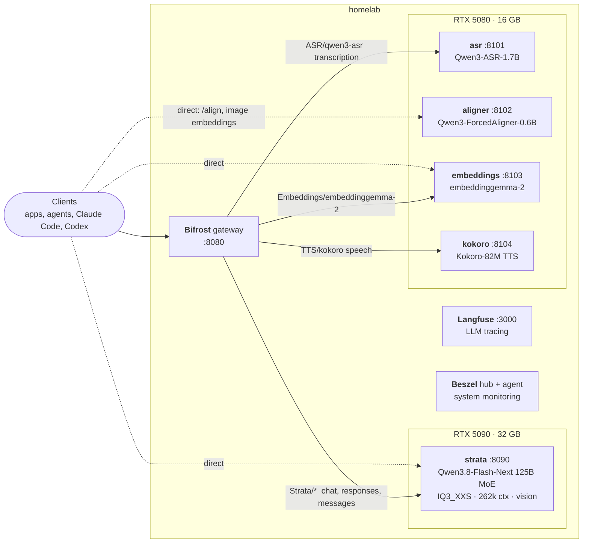
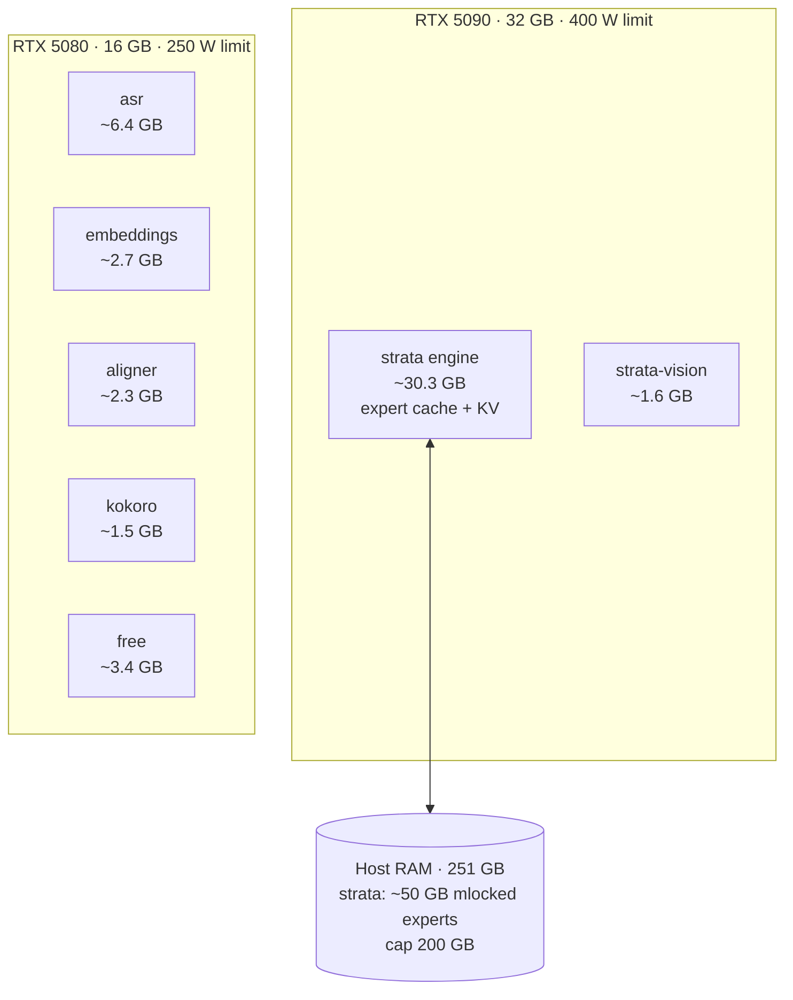
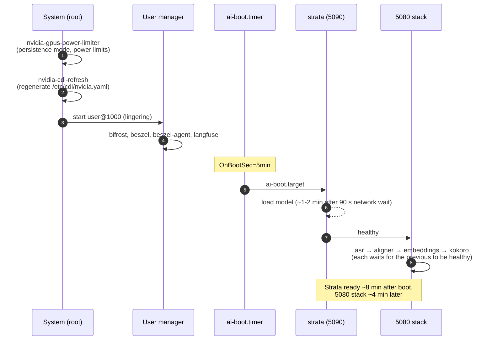

# Devbox AI Lab

Setup for a single-box AI workstation: dotfiles and host config (`bootstrap/`), and
rootless podman quadlets for the model servers and the services around them (`podman/`).

| Host | |
| --- | --- |
| CPU | AMD Threadripper PRO 7965WX (24 cores) |
| RAM | 251 GB |
| GPU 0 | RTX 5090, 32 GB: one large LLM (Strata) |
| GPU 1 | RTX 5080, 16 GB: four small speech/embedding models |
| Access | LAN (`homelab`) and Tailscale; SSH |

## What is served 24/7

As of 2026-10-12. Everything runs as rootless podman under the user's systemd manager
(lingering on, so no login is needed).



All model servers, Bifrost and `langfuse-web` share the `inference` podman network and
reach each other by container name (`http://strata:8080`, `http://asr:8000`, ...).

### Model servers

| Service | GPU | Model | Server | Host port | API |
| --- | --- | --- | --- | --- | --- |
| `strata` | 5090 | Qwen3.8-Flash-Next IQ3_XXS (125B MoE, text + image) | [Strata](https://github.com/Niko1221/Strata), built locally | 8090 | OpenAI, OpenAI Responses, Anthropic `/v1/messages`, web chat |
| `asr` | 5080 | Qwen/Qwen3-ASR-1.7B | `vllm/vllm-openai` | 8101 | `/v1/audio/transcriptions` |
| `aligner` | 5080 | Qwen/Qwen3-ForcedAligner-0.6B | `ai-lab/aligner` (Transformers) | 8102 | `/align` (word timestamps) |
| `embeddings` | 5080 | google/embeddinggemma-2 (text + image, 768-d) | `ai-lab/embeddings` (patched vLLM nightly) | 8103 | `/v1/embeddings` |
| `kokoro` | 5080 | hexgrad/Kokoro-82M (72 voices) | `kokoro-fastapi-gpu` (cu128) | 8104 | `/v1/audio/speech` |

Details, request shapes and gotchas: [`podman/strata/README.md`](podman/strata/README.md),
[`podman/ai-5080/README.md`](podman/ai-5080/README.md).

### Supporting services

| Service | Port | What | Runs from |
| --- | --- | --- | --- |
| Bifrost | 8080 | LLM gateway: one OpenAI-style endpoint in front of all four model providers | `podman/quadlet/bifrost.container` |
| Langfuse | 3000 (web), 9090 (MinIO S3) | LLM tracing/observability: web, worker, Postgres, ClickHouse, Redis, MinIO | `langfuse` submodule + `podman/langfuse/` (podman-compose) |
| Beszel | — | Host/container/GPU monitoring (hub + agent over a unix socket) | `podman/quadlet/beszel*.container` |
| Tailscale | — | Remote access to the box | host package |

Langfuse's Postgres, ClickHouse, Redis and worker only listen on `127.0.0.1`.

## GPU allocation

Each container gets its GPU by UUID through CDI, so the 5090 services can never land on
the 5080 or the other way round. `nvidia-cdi-refresh.service` regenerates the CDI spec
every boot, because the driver does not always number the cards the same way.



| GPU | Used / total | Process | VRAM |
| --- | --- | --- | --- |
| RTX 5090 | 32.0 / 32.6 GB | strata | 30.3 GB |
| | | strata-vision | 1.6 GB |
| RTX 5080 | 12.9 / 16.3 GB | asr (vLLM, `--gpu-memory-utilization 0.45`) | 6.4 GB |
| | | embeddings (vLLM, `0.2`) | 2.7 GB |
| | | aligner | 2.3 GB |
| | | kokoro | 1.5 GB |

Strata fills the 5090 on purpose: it keeps the 125B MoE's experts in RAM (and SSD) and
uses the whole card as an expert cache, so nothing else shares it.

## Boot sequence

Engines loading at the same time as the rest of the system used to black out the box, so
no model service is enabled directly. A timer starts them 5 minutes after boot, one at a
time, each waiting for the previous one's health check (`Notify=healthy`).



A crashed model server restarts after 60 s, at most 3 times in 15 minutes, so a broken
engine cannot loop power spikes.

```bash
systemctl --user status ai-boot.timer strata asr aligner embeddings kokoro
systemctl --user start ai-5080.target    # the four 5080 services, in order
journalctl --user -u strata -f
nvidia-smi --query-compute-apps=pid,process_name,used_memory,gpu_uuid --format=csv
```

## Defined but not running

These quadlets are installed but not started at boot. `vllm` and `ninfer` need the 5090,
so only one of `strata`, `vllm`, `ninfer` can run at a time.

| Service | GPU | What | Port |
| --- | --- | --- | --- |
| `vllm` | 5090 | Qwen3.8-27B NVFP4 on vLLM (180k ctx) | 8001 |
| `ninfer` | 5090 | Qwen3.8-27B NVFP4 on [ninfer](https://github.com/Neroued/ninfer) (MTP speculative decoding) | 8088 |
| `unsloth` | 5090 | Unsloth fine-tuning (training only, start by hand) | 8000, 8888 |
| `openwebui` | — | Open WebUI chat front end | 4000 |
| `postgres` | — | Standalone PostgreSQL 18 | 5432 |

## Containment

- Rootless podman everywhere; model servers run with `DropCapability=ALL` and
  `NoNewPrivileges=true`.
- Models come from the Hugging Face cache, `/srv/models/hub`, mounted **read-only** with
  `HF_HUB_OFFLINE=1`. `/srv/models` itself is `HF_HOME` and holds the HF token, so it is
  never mounted.
- Strata is an untrusted upstream project: it only ever runs inside its container, with a
  200 GB RAM cap ([`podman/strata/README.md`](podman/strata/README.md)).

## Repo layout

| Path | What |
| --- | --- |
| `bootstrap/` | Host setup: packages, dotfiles (bash, nvim, tmux), system units (GPU power limits, CDI refresh, memlock drop-in) |
| `podman/quadlet/` | One `.container` per service, plus the `inference` network |
| `podman/boot/` | `ai-boot.timer` / `ai-boot.target`: delayed, ordered start at boot |
| `podman/ai-5080/` | The RTX 5080 stack's target and README |
| `podman/strata/`, `aligner/`, `embeddings/`, `ninfer/`, `comfyui/` | Image builds |
| `podman/langfuse/` | Langfuse user unit and the compose override that joins the `inference` network |
| `podman/install.sh` | Links the quadlets, installs the targets/timer/Langfuse unit, enables them |
| `langfuse/` | Langfuse upstream (git submodule) |
| `monitor/` | GPU temperature/power logging (`temps.sh`) |

## Install

```bash
sudo bootstrap/system-configuration/install.sh   # system units + memlock drop-in
sudo systemctl restart user@1000.service
cd podman && ./install.sh                        # quadlets, boot timer, Langfuse
```

Images built locally (`strata`, `aligner`, `embeddings`) need their `build.sh` run first.
